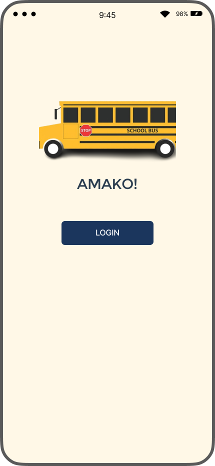
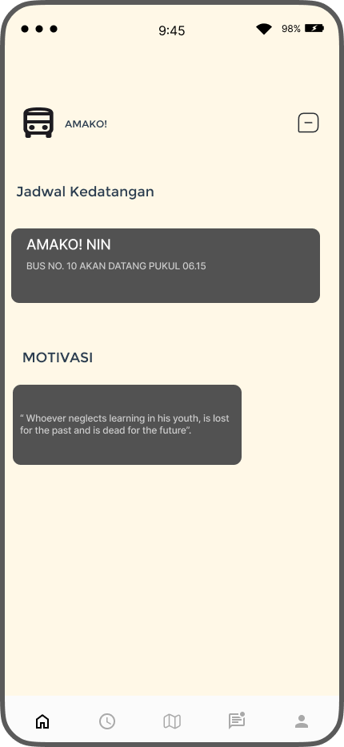
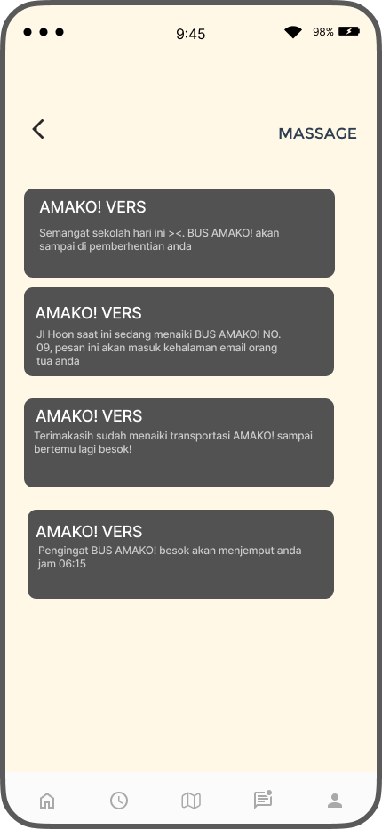
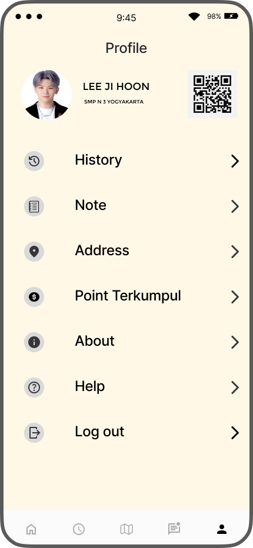
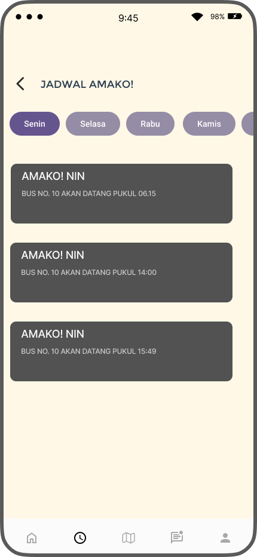
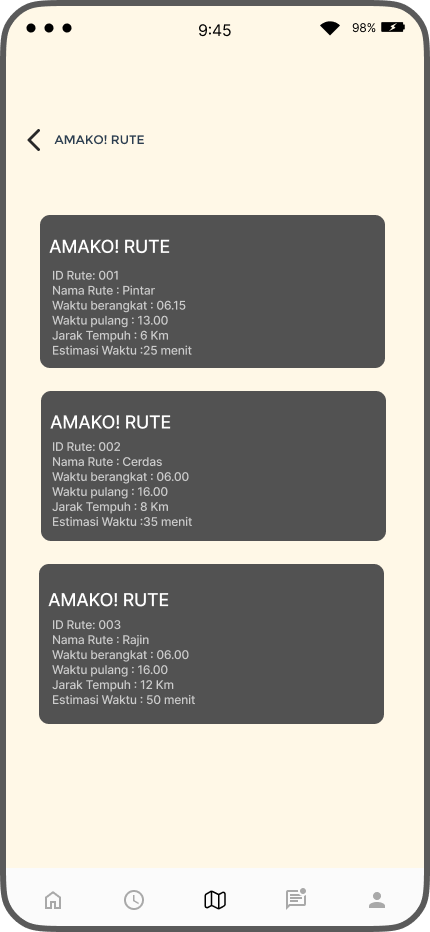
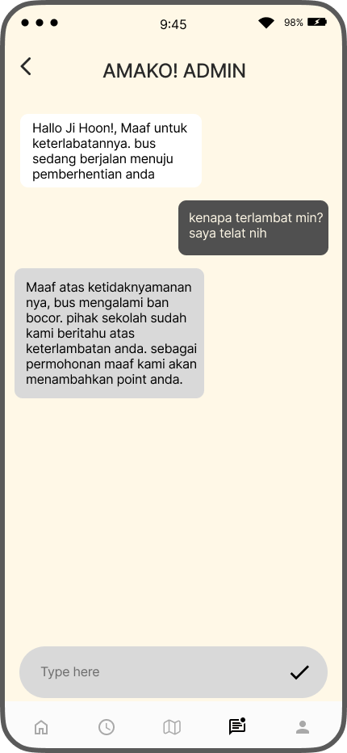
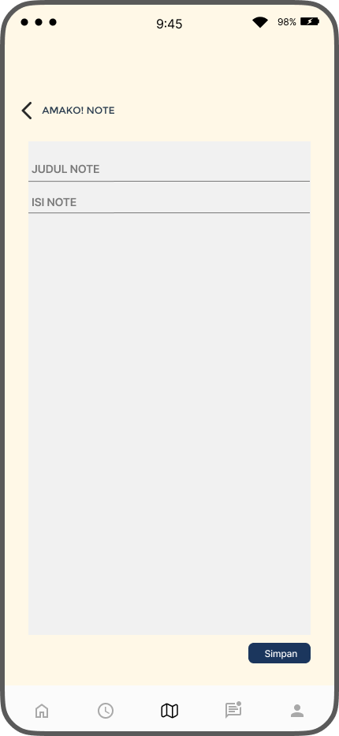

# 🚌 AMAKO — Ayo Mangkat Sekolah

**AMAKO (Ayo Mangkat Sekolah)** adalah konsep UI/UX aplikasi transportasi sekolah yang dirancang untuk mendorong siswa menggunakan bus sebagai alternatif perjalanan ke sekolah.

Ide ini berawal dari melihat bus kuning pengangkut anak sekolah di jalan. Saya berpikir bahwa akan lebih baik jika semakin banyak siswa SMP dan SMA menggunakan transportasi sekolah daripada mengendarai sepeda motor sendiri, terutama untuk membantu mengurangi risiko berkendara di usia muda.

Melalui sistem poin dan hadiah, AMAKO bertujuan memberikan motivasi kepada siswa agar lebih rutin menggunakan bus sekolah.

## 🎯 Project Objectives

- Mendorong penggunaan transportasi sekolah.
- Memberikan alternatif perjalanan ke sekolah bagi siswa.
- Memotivasi siswa melalui sistem poin dan hadiah.
- Menyediakan informasi jadwal dan rute bus dalam satu aplikasi.
- Mendukung perjalanan sekolah yang lebih terorganisasi dan memperhatikan keselamatan.

## ✨ Main Features

- **Login:** Halaman masuk untuk pengguna.
- **Home Dashboard:** Menampilkan informasi dan jadwal kedatangan bus.
- **Bus Schedule:** Melihat jadwal keberangkatan atau kedatangan bus.
- **Bus Routes:** Menampilkan informasi rute perjalanan bus.
- **QR Code Profile:** Rancangan profil pengguna dengan QR Code untuk mendukung identifikasi pengguna dalam sistem.
- **Points and Rewards:** Konsep pemberian poin kepada siswa yang menggunakan bus, dengan peluang menukarkan poin yang terkumpul menjadi hadiah.
- **Messages and Notifications:** Menampilkan pesan dan informasi terkait layanan.
- **Chat:** Menyediakan antarmuka percakapan antara pengguna dan admin.
- **Notes:** Menyediakan halaman untuk mencatat informasi.

## 🎨 UI/UX Design

Desain antarmuka AMAKO dibuat menggunakan Figma dengan tampilan yang sederhana dan berfokus pada kebutuhan pengguna.

### 📱 Design Preview

#### 1. Login

#### 2. Home

#### 3. Message

#### 4. Profile and QR Code

#### 5. Bus Schedule

#### 6. Bus Routes

#### 7. Chat

#### 8. Notes

## 🛠️ Design Tool

- Figma

## 📌 Project Status

**UI/UX Design Concept**

Repository ini mendokumentasikan rancangan antarmuka AMAKO. Fitur dan alur yang dijelaskan merupakan konsep desain, bukan pernyataan bahwa sistem bus, QR Code, penghitungan poin, atau penukaran hadiah sudah diimplementasikan secara fungsional.

## 💡 Future Development

- Integrasi informasi jadwal dan rute bus.
- Pengembangan sistem verifikasi penggunaan bus.
- Penghitungan poin secara otomatis.
- Sistem penukaran poin dengan hadiah.
- Pengembangan notifikasi terkait perjalanan dan poin pengguna.

---

*AMAKO — Ayo Mangkat Sekolah. Encouraging safer and more organized school transportation through a rewarding user experience.*
